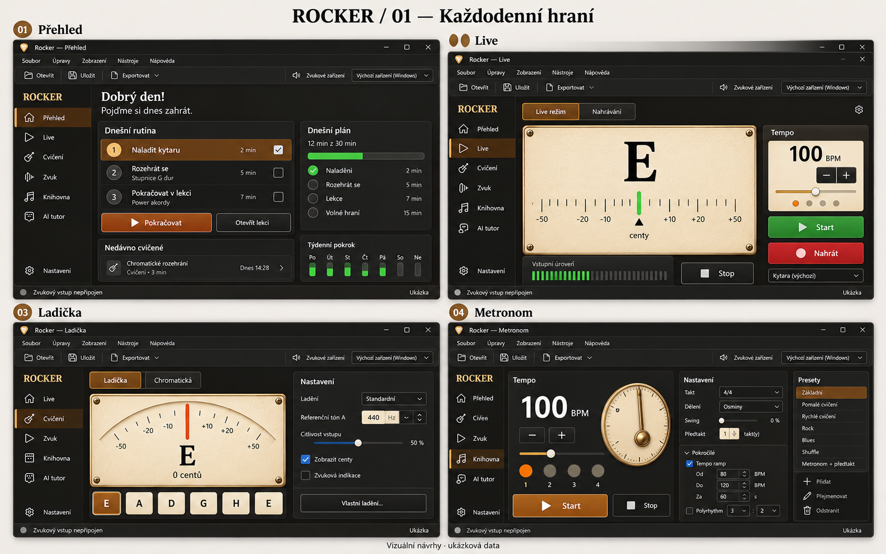
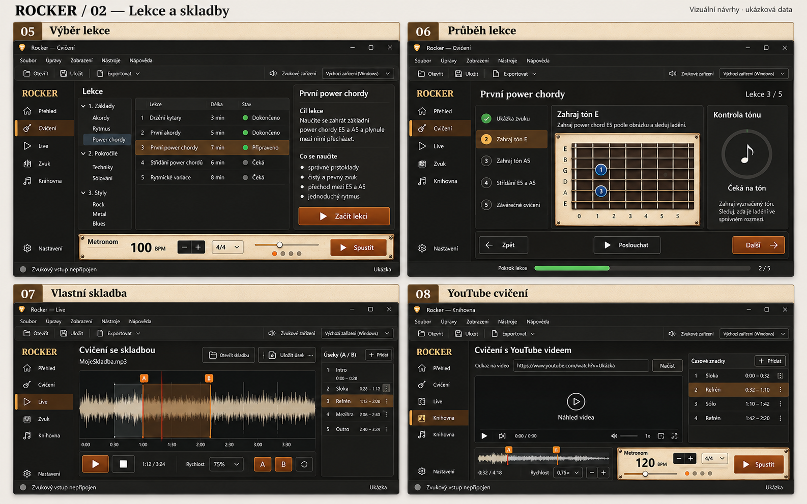
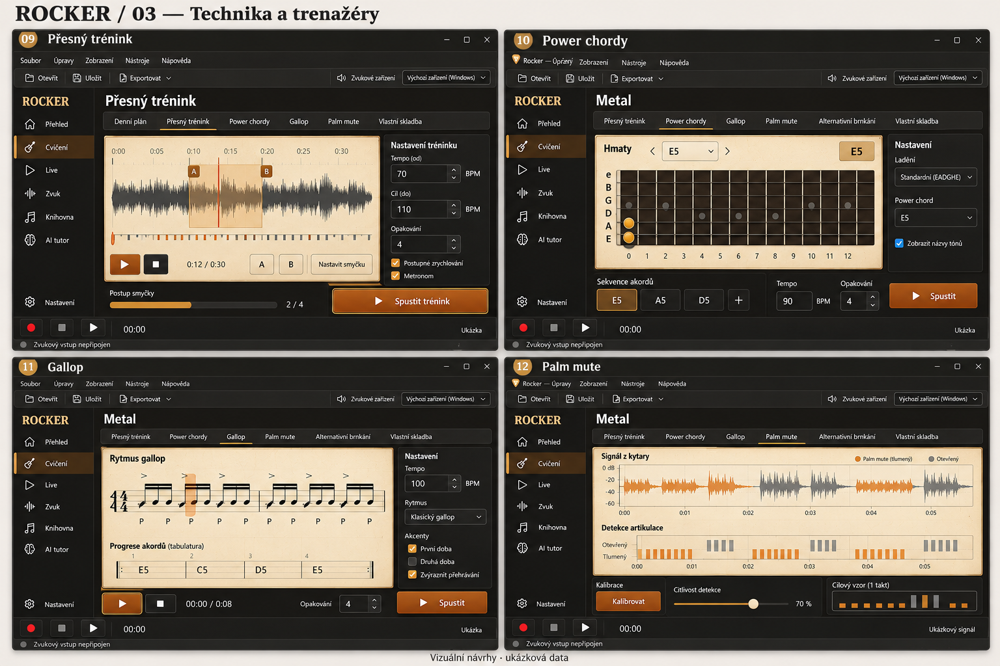
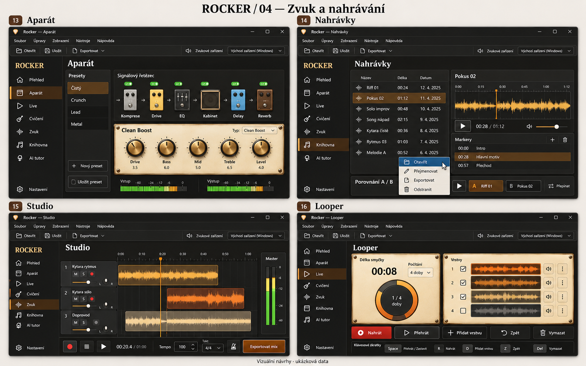
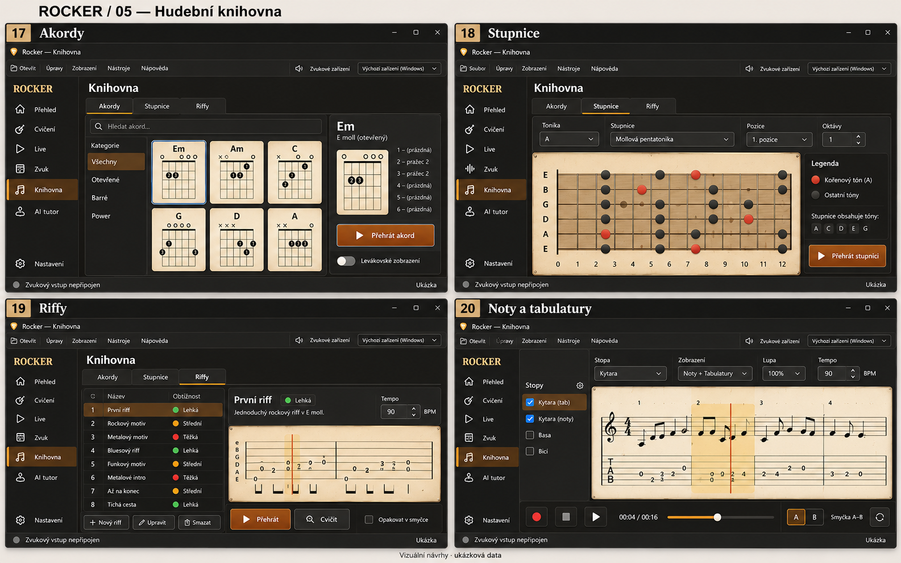
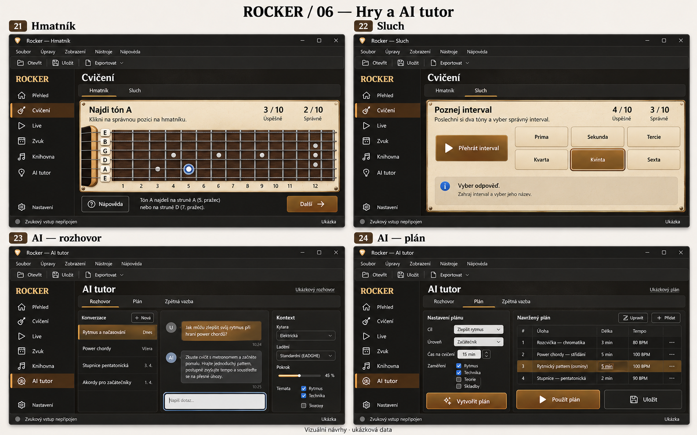
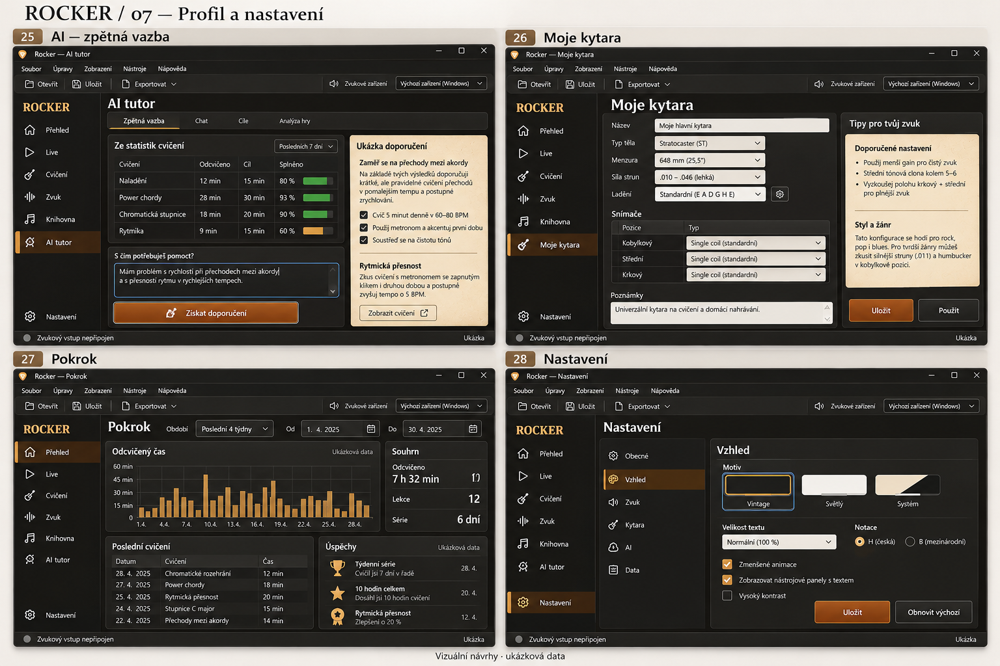
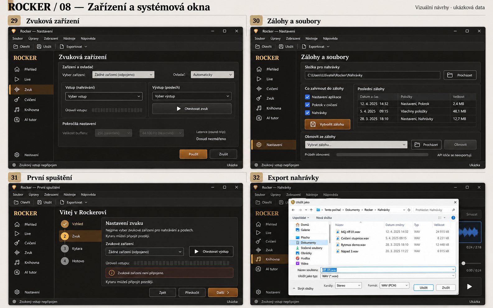

# Rocker pro Windows — všechny návrhy

Vintage, nativní ovládání Windows. **32 pracovních pohledů v 8 listech.** Obrázky jsou koncepční, hodnoty ukázkové.

[Implementační roadmapa](../../../WINDOWS_ROADMAP.md) · [Interaktivní galerie](index.html) · [Specifikace chování](README.md)

## 01 — Každodenní hraní

01 Přehled · 02 Live · 03 Ladička · 04 Metronom

[Otevřít v plné velikosti](boards/01.png)

## 02 — Lekce a skladby

05 Výběr lekce · 06 Průběh lekce · 07 Vlastní skladba · 08 YouTube cvičení

[Otevřít v plné velikosti](boards/02.png)

## 03 — Technika a trenažéry

09 Přesný trénink · 10 Power chordy · 11 Gallop · 12 Palm mute

Přesný trénink zachová i původní tónový drill. Zobrazená waveforma ukazuje doplňující režim úseku skladby; úplné chování určuje specifikace.

[Otevřít v plné velikosti](boards/03.png)

## 04 — Zvuk a nahrávání

13 Aparát · 14 Nahrávky · 15 Studio · 16 Looper

[Otevřít v plné velikosti](boards/04.png)

## 05 — Hudební knihovna

17 Akordy · 18 Stupnice · 19 Riffy · 20 Noty a tabulatury

[Otevřít v plné velikosti](boards/05.png)

## 06 — Hry a AI tutor

21 Hmatník · 22 Sluch · 23 AI — rozhovor · 24 AI — plán

[Otevřít v plné velikosti](boards/06.png)

## 07 — Profil a nastavení

25 AI — zpětná vazba · 26 Moje kytara · 27 Pokrok · 28 Nastavení

[Otevřít v plné velikosti](boards/07.png)

## 08 — Zařízení a systémová okna

29 Zvuková zařízení · 30 Zálohy a soubory · 31 První spuštění · 32 Export nahrávky

[Otevřít v plné velikosti](boards/08.png)

